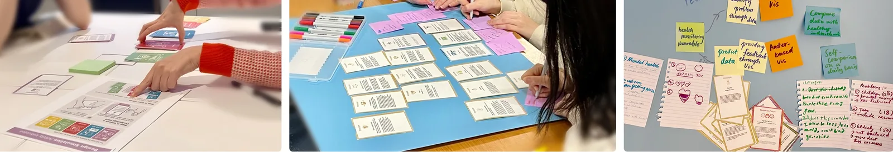
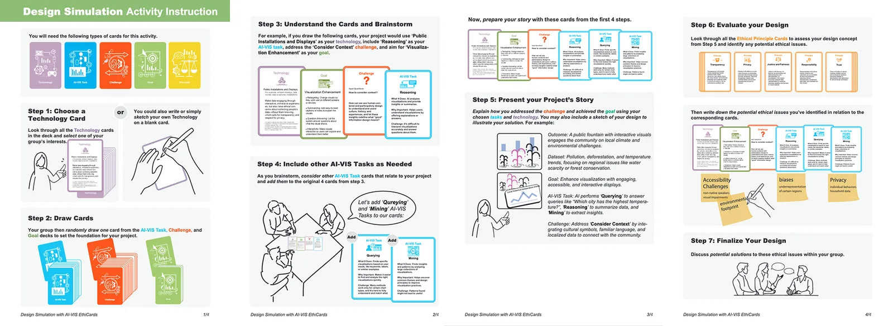

**AI4VIS EthiCards: A Card-Based Approach to Exploring Ethics in AI for Data Visualization Applications** Zezhong Wang, Shan Hao, Sheelagh Carpendale. _Computer Graphics Forum_ [📄**PDF**](/assets/papersPDF/AI_VIS_EthiCards_EuroVis2026-Preprint.pdf){:target="_blank" rel="noopener noreferrer"}

---

AI4VIS EthiCards are a card-based approach designed to facilitate ethical exploration in the growing research of artificial intelligence (AI) for visualization (AI4VIS). The continuously increasing integration of AI and data visualization offers many benefits yet inevitably raises ethical concerns. AI4VIS applications, characterized by their interdisciplinary and multifaceted nature, necessitate that researchers, designers, and practitioners develop ethical awareness and critically reflect on their responsibilities within this domain. The AI4VIS EthiCards, organized into six types, i.e., Goal, AI4VIS Task, Technology, Ethical Principle, People-In-Focus, and Challenge, serve as a framework for discussion and ethical reflection. 

This card deck is designed for students, educators, and practitioners working with AI and visualization, and can be used as a flexible teaching framework, rapid reference, or self-check tool in small-group design and reflection activities. We refined the deck through five workshops across three universities in Canada and China and observed three main outcomes: participants' speculative yet feasible concepts revealed AI4VIS as a high-potential design space; the deck supported more nuanced ethical awareness; and it functioned as a multi-perspective scaffold and shared vocabulary that enabled people from different backgrounds to reason together across technological, user-centred, and value-oriented dimensions.

---
