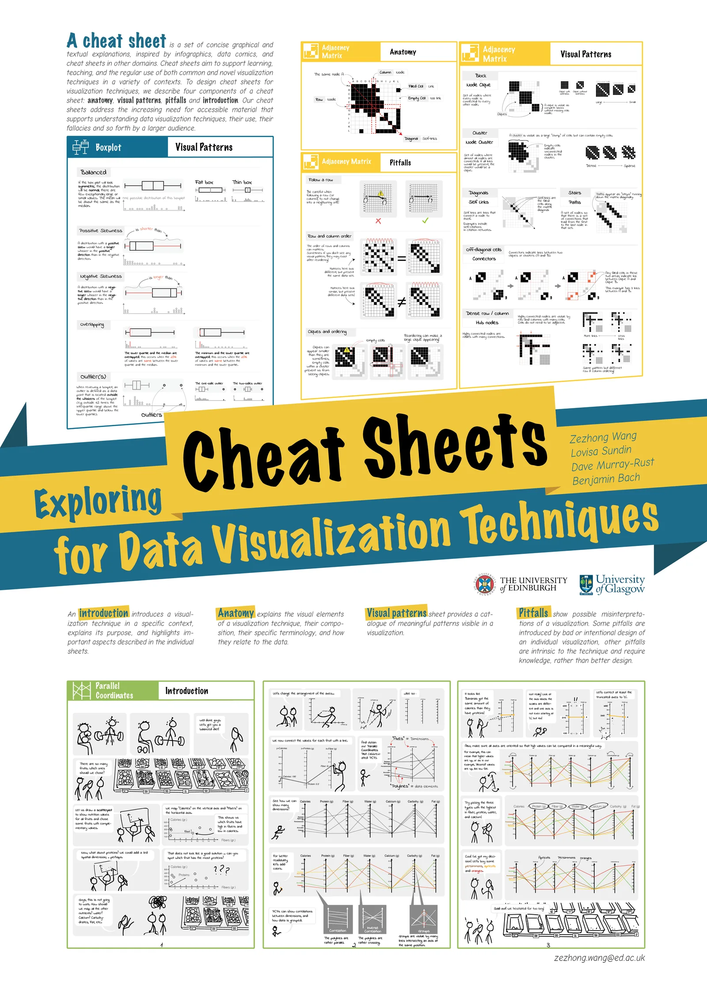
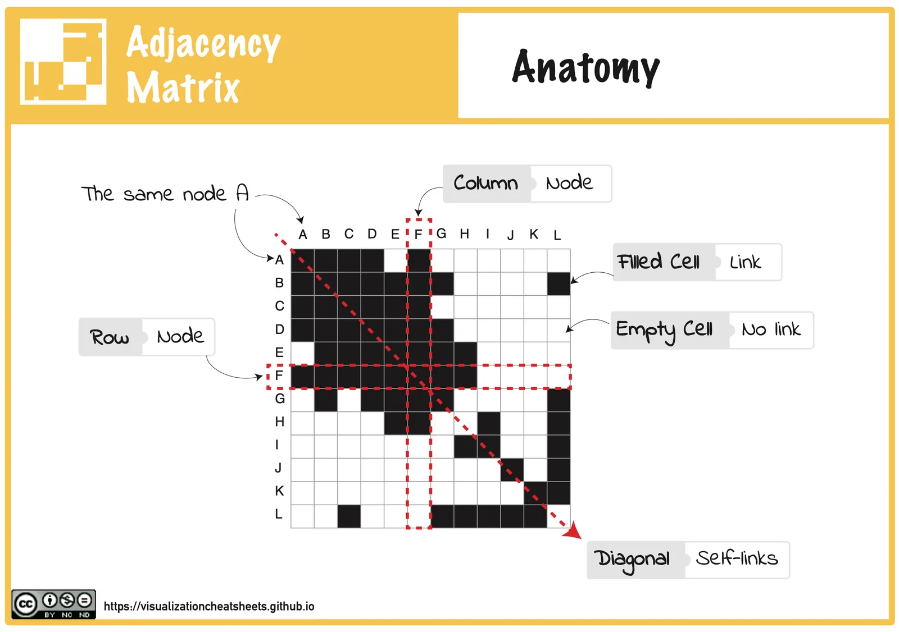
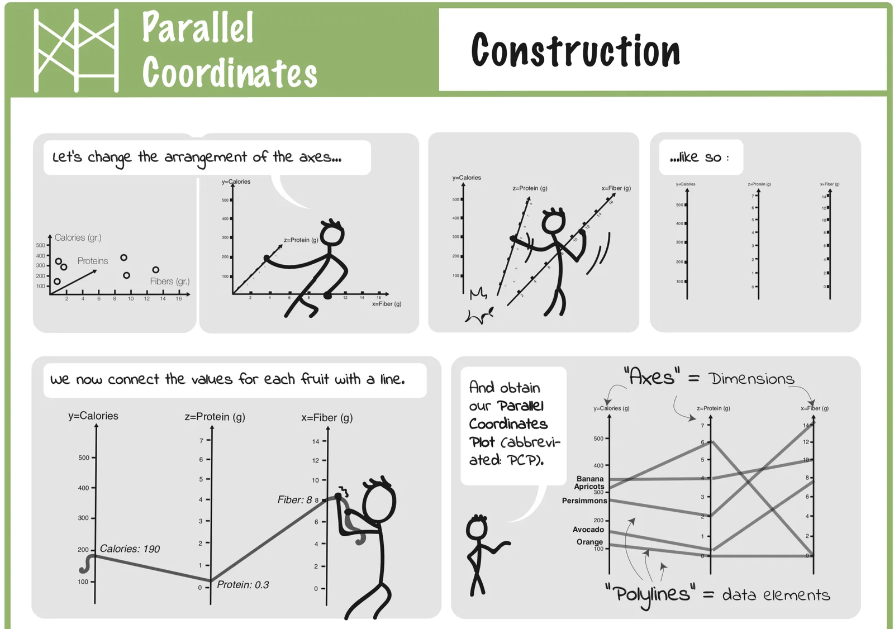
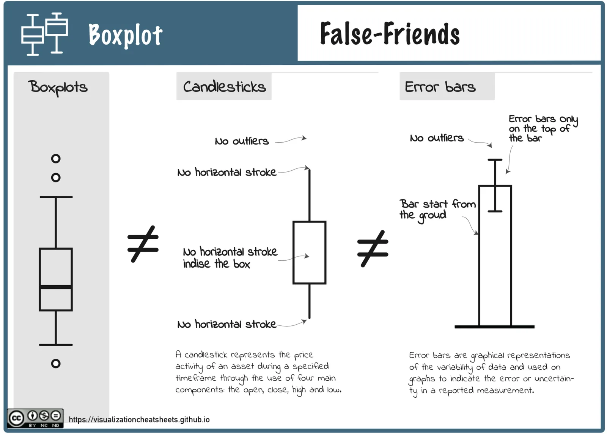
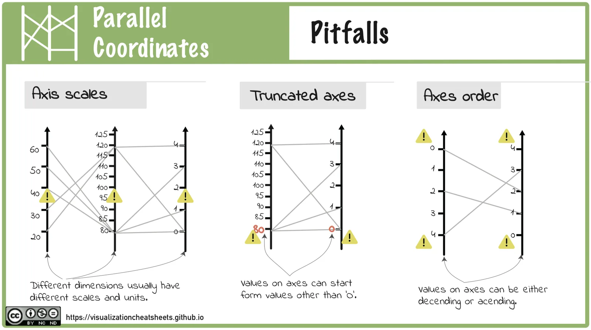
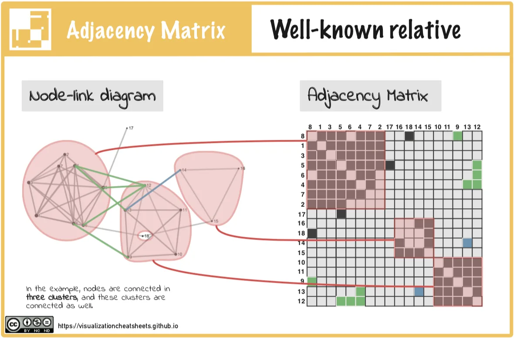
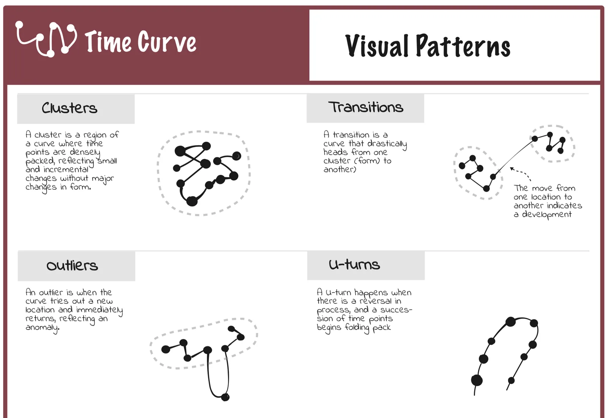

**Cheat Sheets for Data Visualization Techniques** Zezhong Wang, Lovisa Sundin, Dave Murray-Rust, Benjamin Bach _ACM Conference on Human Factors in Computing Systems (CHI 2020)_) [📄**PDF**](https://www.researchgate.net/publication/338657160_Cheat_Sheets_for_Data_Visualization_Techniques){:target="_blank" rel="noopener noreferrer"}

### Video Preview (30 sec)

  

    <iframe src="https://www.youtube.com/embed/SfSgIvn-99U" style="position: absolute; top: 0; left: 0; width: 100%; height: 100%;" frameborder="0" allow="accelerometer; autoplay; clipboard-write; encrypted-media; gyroscope; picture-in-picture" allowfullscreen></iframe>
  

---

This project introduces the concept of 'cheat sheets' for data visualization techniques, a set of concise graphical explanations and textual annotations inspired by infographics, data comics, and cheat sheets in other domains. Cheat sheets aim to address the increasing need for accessible material that supports a wide audience in understanding data visualization techniques, their use, their fallacies, and so forth. We have carried out an iterative design process with practitioners, teachers, and students of data science and visualization, resulting in six types of cheat sheets (anatomy, construction, visual patterns, pitfalls, false-friends, and well-known relatives) for six types of visualization, and formats for presentation. We assess these with a qualitative user study using 11 participants that demonstrate the readability and usefulness of our cheat sheets.

Poster presented at VIS 2019 was awarded both *‘Best Poster Research’* and *‘Best Poster Design’* awards (InfoVis).

  <!-- Image 1 -->
  

    
    

      Anatomy
      <!-- 

        My weekly data comic practice example
      
 -->
    

  

  <!-- Image 2 -->
  

    
    

      Construction
      <!-- 

        My weekly data comic practice example
      
 -->
    

  

  <!-- Image 3 -->
  

    
    

      False Friends
      <!-- 

        My weekly data comic practice example
      
 -->
    

  

  <!-- Image 4 -->
  

    
    

      Pitfalls
      <!-- 

        My weekly data comic practice example
      
 -->
    

  

  <!-- Image 5 -->
  

    
    

      Well-known Relative
      <!-- 

        My weekly data comic practice example
      
 -->
    

  

  <!-- Image 6 -->
  

    
    

      Visual Patterns
      <!-- 

        My weekly data comic practice example
      
 -->
    

  

     
Find more examples and download the whole pack of cheatsheets on the [project website](https://visualizationcheatsheets.github.io/){:target="_blank" rel="noopener noreferrer"}.

---
