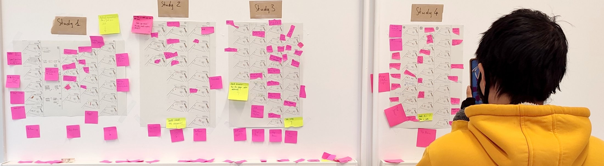

**Toward Visual Methods: Reflections on How Visuals Enrich Empirical Research** Zezhong Wang, Sheelagh Carpendale, Samuel Huron. _IEEE VIS 2026 BELIV Workshop_ [📄**PDF**](/assets/papersPDF/BELIV2026_Toward_Visual_Methods.pdf){:target="_blank" rel="noopener noreferrer"}

**Summary of the Workshop on Visual Methods and Analyzing Visual Data in Human Computer Interaction** Zezhong Wang, Samuel Huron, Miriam Sturdee, Sheelagh Carpendale. _Companion Proceedings of the Conference on Interactive Surfaces and Spaces (ISS 2024)_ [📄**PDF**](https://www.researchgate.net/publication/385287571_Summary_of_the_Workshop_on_Visual_Methods_and_Analyzing_Visual_Data_in_Human_Computer_Interaction){:target="_blank" rel="noopener noreferrer"}

---

In human-computer interaction and visualization research, more and more of what we study and collect is visual in nature: sketches, screenshots, photographs, videos, interfaces, and images of physical objects and spaces. Analyzing visual material has a rich tradition in the social sciences and the arts, yet it is rarely reflected on in information visualization or interface design, even though visual design is often the primary channel for communicating data.

A researcher analyzing a mosaic of 93 speculative design sketches from several workshops. Photo by Samuel Huron, CC BY, <a href="https://osf.io/fd6v8/" target="_blank" rel="noopener noreferrer">osf.io/fd6v8</a>.

[Visual Methods](https://visualmethods.pages.dev/){:target="_blank" rel="noopener noreferrer"} is an open, growing archive of methods for working with visual data. Each method is distilled from a published study and written up as a step-by-step recipe that anyone can follow, shown with the figures, materials, and moves of the research it came from. Methods are organized by three purposes: **gathering** (eliciting and collecting visual data), **understanding** (analyzing and interpreting it), and **communicating** (presenting it to others).

The archive grew out of our BELIV 2026 paper, in which we reflect on six cases drawn from 25 years of our own qualitative studies and surveys, and discuss four values and practical strategies for using visual methods. It also builds on the Visual Methods & Analyzing Visual Data in HCI workshop we co-organized at ISS 2024. Researchers, designers, and educators are welcome to [submit a method](https://visualmethods.pages.dev/submit.html){:target="_blank" rel="noopener noreferrer"}.

---
